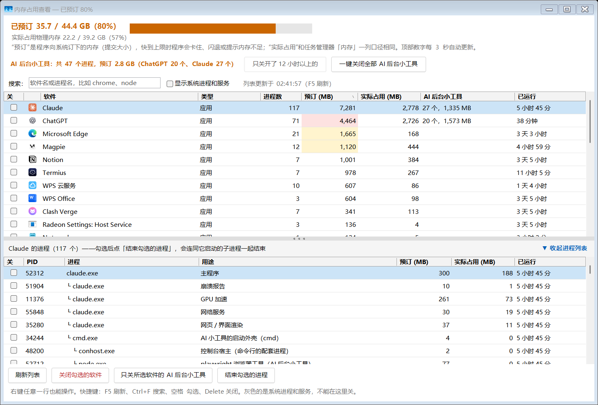

# 内存占用查看（memory-monitor）

一个 Windows 小工具：**按软件分组**显示内存占用，把每个软件连同它启动的全部子进程算在一起，特别是把 AI 软件（Claude、ChatGPT/Codex 等）在后台开的一大堆小工具也算清楚，勾选后一键关闭。

任务管理器里常常是几十个 `node.exe`、`conhost.exe`、`chrome.exe`，看不出谁是谁开的、开了多久。这个工具把它们按“谁启动的”归到对应软件名下，告诉你每个进程是干什么的，哪些可以放心关。



- 不用安装：Windows 自带的 PowerShell 5.1 就能运行，一个脚本文件，没有任何第三方依赖。
- 只在本机运行：只读取本机进程信息，不联网，不上传任何数据。
- 不需要管理员权限（系统进程本来也不让关）。

## 它能帮你做什么

1. **看清楚内存到底被谁占了**：每个软件一行，数字包含它的全部子进程。比如 Claude 名下 117 个进程、预订 7 GB，一眼就能看出来，不用在任务管理器里一个个加。
2. **排查“虚拟内存不足”、程序闪退、卡顿**：顶部显示“已预订 / 上限”（提交内存）。到 75% 变橙、90% 变红。物理内存还有空闲，程序却闪退或提示内存不足，多半是这里满了。
3. **清理 AI 软件留下的后台小工具**：AI 软件每开一个会话就会启动一批后台小工具（playwright 浏览器、MCP 工具、REA 逆向工具等），会话结束了也不会关，越积越多，常常占好几个 GB。
   - **只关开了 12 小时以上的**：只清旧会话留下的，一般不会打断正在用的对话。
   - **一键关闭全部**：所有软件名下的全部清掉，软件本身不关。
   - **只关所选软件的**：只清某一个软件的。
4. **找某个进程是哪个软件开的**：搜索框可以搜进程名，比如输入 `node`、`python`、`playwright`，马上看到它们挂在哪个软件下面，下表里命中的进程标黄色。
5. **彻底关掉一个软件**：连同它的全部子进程一起结束。点“×”往往只是把窗口藏到托盘，后台还在跑。
6. **发现关不掉的软件**：带守护进程或开机服务的软件，关掉后会马上自己重新启动，工具会提示你去它自己的设置里关掉开机启动或后台运行。
7. **查看进程的来龙去脉**：右键可以打开文件所在位置、复制程序路径、复制完整命令行，方便排查可疑进程，或者确认某个进程是干什么的。
8. **看哪些东西在后台常驻**：勾选“显示系统进程和服务”，能看到 NVIDIA、联想、SQL Server 这类后台服务各占多少（这些只能看，不能在这里关）。
9. **和任务管理器对照**：“实际占用”用的是专用工作集，和任务管理器“内存”那一列口径一致。另外多了一列“预订”，这是任务管理器默认不显示的。

## 快速开始

1. 下载本仓库（Code → Download ZIP），解压到任意文件夹。
2. 双击 `launch.vbs` 运行；或者右键 `create-shortcut.ps1` →“使用 PowerShell 运行”，会在桌面建一个“内存占用查看”快捷方式。
3. 如果双击 `.ps1` 被系统拦截，用 `launch.vbs` 或快捷方式启动即可，它们会以 `-ExecutionPolicy Bypass` 方式运行，不需要修改系统设置。

运行环境：Windows 10 / 11（64 位），Windows PowerShell 5.1（系统自带）。

## 界面说明

**顶部**

- **已预订 x / y GB**：所有程序向系统订下的内存（提交大小）和上限（物理内存 + 虚拟内存）。每 3 秒自动更新，窗口标题上也显示百分比。
- **实际占用物理内存**：现在真正用掉的物理内存。
- **AI 后台小工具汇总**：一共多少个、预订多少、分别属于哪个软件、其中多少个开了超过 12 小时，旁边是两个一键清理按钮。

**上表：软件列表**

| 列 | 含义 |
|---|---|
| 软件 | 带图标的软件名。脚本类程序（Python、Node、PowerShell）显示脚本名和所在文件夹 |
| 类型 | 应用、后台程序、你的后台服务、系统、系统服务；后两种是灰色，不能在这里关 |
| 进程数 | 这个软件连同子进程一共多少个 |
| 预订 (MB) | 提交内存；超过 1 GB 标黄，超过 2 GB 标红 |
| 实际占用 (MB) | 专用工作集，和任务管理器“内存”一列一样 |
| AI 后台小工具 | 这个软件开的 AI 小工具数量和预订量，就是“只关 AI 后台小工具”会关的那些；有超过 12 小时的标橙色 |
| 已运行 | 这个软件最早的进程开了多久 |

点表头可以排序。鼠标停在列名上会显示说明。

**下表：所选软件的全部进程**

按父子关系缩进显示，“用途”一列说明每个进程是干什么的，比如“网页 / 界面渲染”“GPU 加速”“playwright 浏览器工具（AI 后台小工具）”“控制台宿主”。开了超过 12 小时的 AI 小工具标橙色，搜索命中的进程标黄色。

下表可以收起：点标题栏右边的“▼ 收起进程列表”，或者双击分隔线、把分隔线拖到最底下，上表就能多显示一倍的软件。收起后双击上表任意一个软件，会自动展开。

## 操作方式

**按钮**

- **刷新列表**：重新读取所有进程。切回窗口时，如果列表超过 1 分钟没更新、又没勾选任何东西，也会自动刷新。
- **关闭勾选的软件**：结束上表勾选的软件，连同它的全部子进程。
- **只关所选软件的 AI 后台小工具**：只结束当前选中软件名下的 AI 小工具。
- **结束勾选的进程**：结束下表勾选的进程，连同它们启动的子进程。

**右键菜单**

- 上表：关闭这个软件、只关它的 AI 后台小工具、打开文件所在位置、复制程序路径。
- 下表：结束这个进程（连同子进程）、打开文件所在位置、复制命令行。

**快捷键**

| 按键 | 作用 |
|---|---|
| F5 | 刷新列表 |
| Ctrl+F | 跳到搜索框 |
| Esc | 清空搜索 |
| 空格 | 勾选 / 取消当前行 |
| Delete | 关闭：有勾选的就关勾选的，没有就关当前选中的（都会先弹窗确认） |

## 安全设计

- **每次关闭前都会弹窗确认**，列出要结束的内容和预订量。关掉“你的后台服务”、Claude、Codex、ChatGPT、WPS 这类软件时，会额外提醒可能的影响。
- **先礼后兵**：有窗口的程序先请它自己正常关闭，最多等 3 秒，让它有机会保存，之后才强制结束。
- **系统进程和服务不能勾选**：灰色显示，只能查看。
- **防止误杀**：结束前会核对进程的启动时间，避免进程编号（PID）被别的程序重新占用后关错。
- **不会关掉自己**。
- 关完会显示“已预订从 A GB 降到 B GB”，以及没能结束的进程（比如需要管理员权限的）。

## 个人配置（可选）

把 `local-config.example.json` 复制一份，改名为 `local-config.json`，放在脚本旁边。这个文件已经写进 `.gitignore`，不会被提交。

```json
{
  "importantServices": [
    { "pattern": "my-tunnel\\.py", "name": "我的内网穿透隧道" }
  ],
  "customPurposes": [
    { "pattern": "my-mcp-server", "purpose": "我自己的 MCP 服务（不当作 AI 后台小工具）" }
  ]
}
```

- `importantServices`：你自己的后台服务，比如隧道、自动重连脚本。它们会显示为“你的后台服务”，关之前会额外提醒。
- `customPurposes`：给特定进程起名字。比如你自己写的 MCP 服务，登记后就不会被当成 AI 后台小工具清掉。
- `pattern` 是正则表达式，用来匹配进程的命令行和程序路径。

其他设置：

- “旧”的判断标准默认是 12 小时，可以改脚本开头的 `$StaleHours`。
- 窗口位置和大小、上下比例、下表是否收起、是否显示系统进程，关闭时自动保存在 `%LOCALAPPDATA%\memory-monitor\settings.json`，删掉这个文件就恢复默认。

## 常见问题

**“预订”和“实际占用”有什么区别？**

“预订”（提交大小）是程序向 Windows 订下、Windows 保证随时能给的内存。很多程序（浏览器、Electron 应用、Node）习惯多订少用，所以预订通常比实际占用大。所有程序的预订加起来不能超过上限（物理内存 + 虚拟内存），满了以后新的内存请求会失败，程序就会闪退、卡住或报“内存不足”，哪怕物理内存还有空闲。“实际占用”是现在真正占着的物理内存。

**为什么数字和任务管理器的不一样？**

“实际占用”和任务管理器“内存”一列口径一致（专用工作集），但这里是把一个软件的全部子进程加在一起的，任务管理器里是分散显示的。“预订”对应任务管理器“详细信息”页里的“提交大小”列，默认不显示。

**AI 后台小工具是怎么认出来的？**

按进程的命令行识别：`node.exe` 带 `playwright` 的是浏览器工具，带 `rea.mjs` 的是 REA 逆向工具，带 `mcp` 的是 MCP 工具，以及它们拉起的 Java 等子进程。软件本体和它自己的必要组件不会被算进去。识别规则在脚本的 `Get-Purpose` 函数里，可以按需补充。

**关掉 AI 小工具会怎样？**

软件本身不受影响。正在用这些工具的对话，下一次调用工具时可能报错，新开一个对话就会重新启动它们。

**为什么有的进程关不掉？**

系统进程和服务不允许在这里关。另外，以管理员身份运行的程序需要本工具也以管理员身份运行才能结束，结果里会列出这些进程。

**刷新要一两秒正常吗？**

正常。时间主要花在 Windows 读取所有进程的命令行上（通过 WMI），500 个进程大约 1.5 秒。“实际占用”是通过 `NtQuerySystemInformation` 一次读完的，只要几毫秒。

## 文件说明

| 文件 | 说明 |
|---|---|
| `memory-monitor.ps1` | 主程序（Windows PowerShell 5.1 + WinForms）。必须保存为带 BOM 的 UTF-8，否则中文会乱码 |
| `launch.vbs` | 不弹黑窗口的启动器 |
| `create-shortcut.ps1` | 在桌面创建快捷方式，也可以用 `-Path` 指定位置 |
| `local-config.example.json` | 个人配置示例 |
| `docs/screenshot.png` | 界面截图 |

## 开发与测试

脚本自带四种测试模式，改完代码建议都跑一遍：

```powershell
# 在控制台打印分组结果、采集耗时
powershell -File memory-monitor.ps1 -List

# 起一个临时进程树（cmd → conhost → ping），验证关闭逻辑
powershell -File memory-monitor.ps1 -SelfTest

# 把界面截图保存后退出（加 -Collapsed 截收起状态）
powershell -STA -File memory-monitor.ps1 -Snapshot a.png

# 端到端测试：起临时进程，依次走所有按钮、右键菜单、搜索、收起展开、快捷键、
# 自动刷新、守护进程提示等 37 项检查，结果写进日志
powershell -STA -File memory-monitor.ps1 -UiTest t.log
```

`-UiTest` 只会结束测试自己启动的临时进程。涉及 AI 小工具的两个“一键关闭”按钮，测试里都会在确认框回答“否”，不会真的关掉你的 AI 小工具。

写代码时注意：PowerShell 会把中文弯引号 `“ ”` 当成英文双引号，双引号字符串里不要用。

## 许可证

[MIT](LICENSE)
